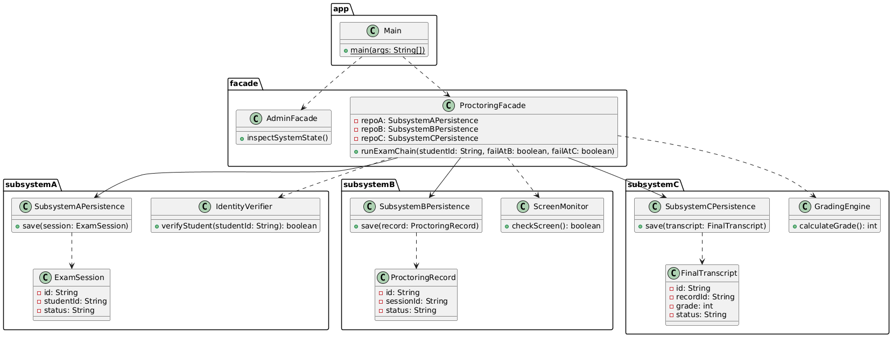

# Assignment 4: Facade Pattern over Three-Stage Chain (Exam Proctoring)

## Domain: Exam Proctoring
- **Subsystem A (Intake):** `IdentityVerifier`, `ExamSession` (Status: `NEW`, `VERIFIED`, `CANCELLED`)
- **Subsystem B (Execution):** `ScreenMonitor`, `ProctoringRecord` (Status: `NEW`, `MONITORED`, `FAILED`)
- **Subsystem C (Finalization):** `GradingEngine`, `FinalTranscript` (Status: `NEW`, `RECORDED`, `REVOKED`)

---

## UML Class Diagram



---

## Principle of Least Knowledge (Law of Demeter)

### Before (Without Facade):
Clients have to directly couple with all three subsystems and manage deep dependency chains:
```java
IdentityVerifier verifier = new IdentityVerifier();
if (verifier.verifyStudent(studentId)) {
    ExamSession session = new ExamSession("S1", studentId, "VERIFIED");
    new SubsystemAPersistence().save(session);

    ScreenMonitor monitor = new ScreenMonitor();
    if (monitor.checkScreen()) {
        ProctoringRecord record = new ProctoringRecord("R1", session.getId(), "MONITORED");
        new SubsystemBPersistence().save(record);

        GradingEngine engine = new GradingEngine();
        FinalTranscript transcript = new FinalTranscript("T1", record.getId(), engine.calculateGrade(), "RECORDED");
        new SubsystemCPersistence().save(transcript);
    }
}